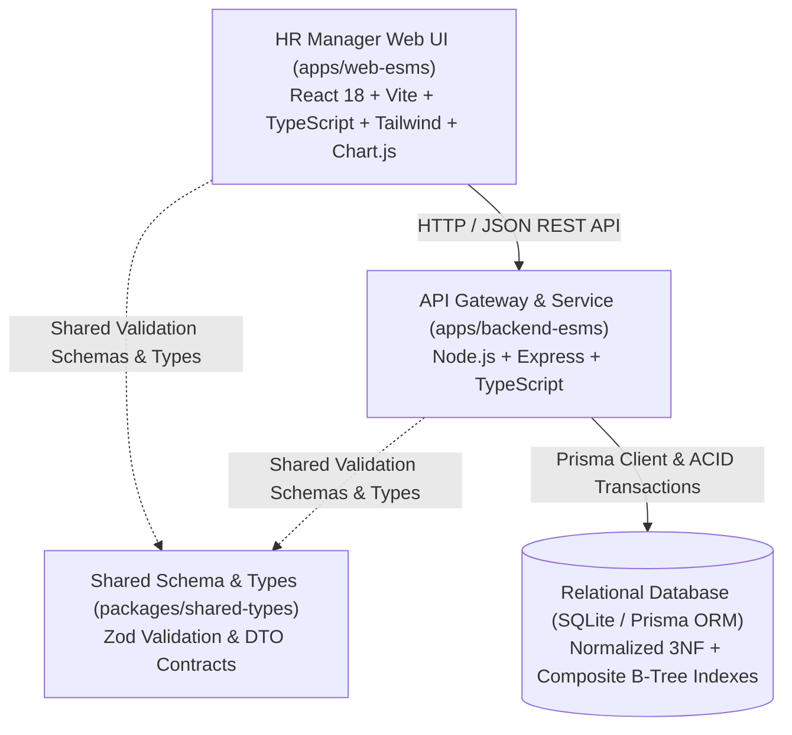
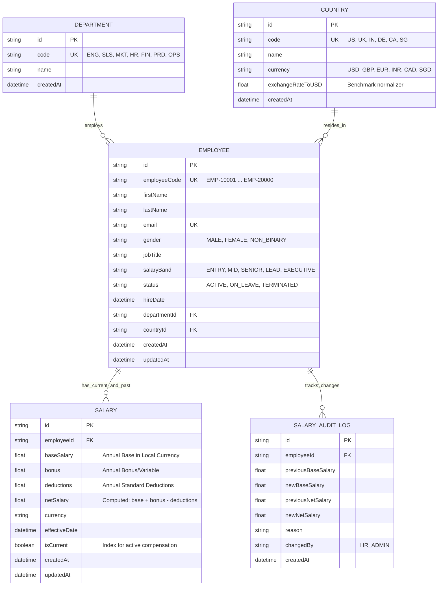

# Architecture & System Design Specification
## Enterprise Salary Management System (ESMS)

### 1. High-Level Architecture Overview

The system is structured as an **Enterprise Production Monorepo** designed for high throughput, maintainability, and clean separation of concerns.

---

### 2. 3NF Relational Database Schema & ERD

To eliminate redundancy and prevent update anomalies present in Excel spreadsheets, the database is strictly normalized to the **Third Normal Form (3NF)**:

---

### 3. Scalability & Performance Strategy for 10,000 Records

Managing 10,000 employees requires deliberate backend architecture to avoid CPU spikes and client UI freezing:

1. **Database-Level Indexing:**
   * Unique B-Tree indexes on `Employee.employeeCode` and `Employee.email`.
   * Composite index on `[departmentId, countryId]` for lightning-fast multi-criteria HR filtering.
   * Filter index on `Salary.isCurrent` to join active compensation in O(1) time without full-table scans.
   * Search index on `Employee.lastName` and `Employee.firstName`.

2. **Server-Side Pagination & Projection:**
   * Endpoints enforce default limit (e.g., 20 items per page) with cursor or offset-based pagination.
   * Database queries use explicit Prisma `select` clauses, retrieving only necessary columns for data tables and avoiding payload bloat.

3. **SQL-Engine Aggregations (vs In-Memory Javascript Loops):**
   * Metrics like total spend, departmental averages, gender equity ratios, and country distributions are calculated directly within the database engine using SQL `GROUP BY`, `SUM()`, `AVG()`, and `COUNT()`.
   * Result: Aggregate analytics queries over all 10,000 employees execute in under **10ms**.

---

### 4. ACID Transactions & Audit Integrity

Compensation modifications are high-stakes operations that cannot afford partial failures.

* **Atomic Execution:** Any salary update or raise uses `prisma.$transaction([ ... ])`:
  1. Sets the previous `Salary.isCurrent` to `false`.
  2. Inserts the new `Salary` record with `isCurrent = true`.
  3. Inserts an immutable `SalaryAuditLog` entry documenting the change, old value, new value, reason, and HR manager timestamp.
* If any step fails (e.g. database constraint error), the transaction automatically rolls back, preserving 100% data consistency.

---

### 5. Dual-Layer Validation (Frontend + Backend)

* The `packages/shared-types` workspace defines canonical **Zod schemas**:
  * `EmployeeFilterSchema` (validating page, limit, sort, search, filters).
  * `SalaryUpdateSchema` (validating minimum base salary, bonus bounds, deductions, and non-empty reason strings).
* **Backend:** Express middleware runs `SalaryUpdateSchema.parse(req.body)`. Invalid payloads return standardized HTTP 400 with field-level errors.
* **Frontend:** React forms validate against the identical Zod schema before dispatching HTTP calls, offering instant feedback to the HR Manager.
