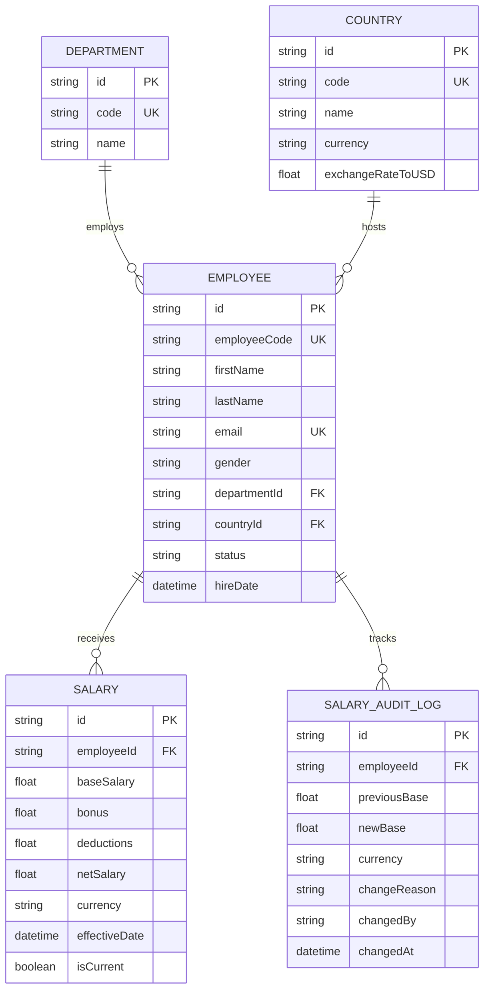

# System Architecture & Technical Design Specification

## 1. Overview
The **Enterprise Employee Salary Management System (ESMS)** is architected to deliver sub-10ms response times on queries across 10,000+ employees while maintaining strict ACID transactional integrity and multi-currency consistency.

---

## 2. High-Level Architecture

```text
┌────────────────────────────────────────────────────────┐
│                      Client Layer                      │
│        React 19 + TypeScript + Vite + Tailwind CSS     │
│       - Analytics Dashboard (Chart.js / Lucide)        │
│       - Server-side Data Grid & Filter Bar             │
│       - Salary Modification Modal (Zod Form)           │
└───────────────────────────┬────────────────────────────┘
                            │ HTTP / JSON
                            ▼
┌────────────────────────────────────────────────────────┐
│                   Backend API Layer                    │
│             Node.js + Express + TypeScript             │
│       - REST API Routes (/api/employees, /api/analytics│
│       - Shared Zod Validation Middleware               │
│       - Service Layer (SalaryService, AnalyticsService)│
└───────────────────────────┬────────────────────────────┘
                            │ Prisma ORM Client
                            ▼
┌────────────────────────────────────────────────────────┐
│                 Data Persistence Layer                 │
│              SQLite Relational Database                │
│       - 3NF Normalized Schema                          │
│       - B-Tree Composite Indexes                       │
│       - Atomic Transactions ($transaction)             │
└────────────────────────────────────────────────────────┘
```

---

## 3. Relational Database Normalization (3NF)

To prevent data redundancy, update anomalies, and inconsistencies present in Excel spreadsheets, the schema is decomposed into 5 distinct entities:



---

## 4. Performance Strategy for 10,000+ Records

1. **Server-Side Pagination & Projection:**
   * Queries use `skip` and `take` at the database level with lightweight projection (only fetching necessary fields).
2. **Targeted B-Tree Indexing:**
   * Index on `[departmentId, countryId]` for rapid multi-filter combinations.
   * Unique B-Tree indexes on `employeeCode` and `email` for $O(1)$ lookups.
   * Composite index on `[employeeId, isCurrent]` for instantaneous salary retrieval.
3. **Database Transactions (`prisma.$transaction`):**
   * Updating an employee's compensation is strictly executed inside an atomic transaction:
     ```typescript
     await prisma.$transaction(async (tx) => {
       // 1. Mark existing salary record isCurrent = false
       // 2. Insert new salary record isCurrent = true
       // 3. Create immutable SalaryAuditLog entry
     });
     ```
   * If any step fails, the entire transaction rolls back, preventing data corruption.

---

## 5. Dual-Tier Validation Pipeline

* **Layer 1 (Client-Side):** Real-time Zod validation provides instant user feedback before submitting forms.
* **Layer 2 (Server-Side):** Strict Express request middleware validates payloads against the exact same Zod schema, rejecting malformed requests with `400 Bad Request`.
